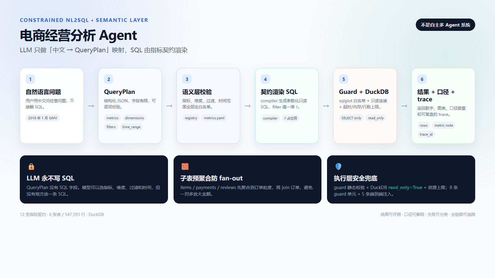
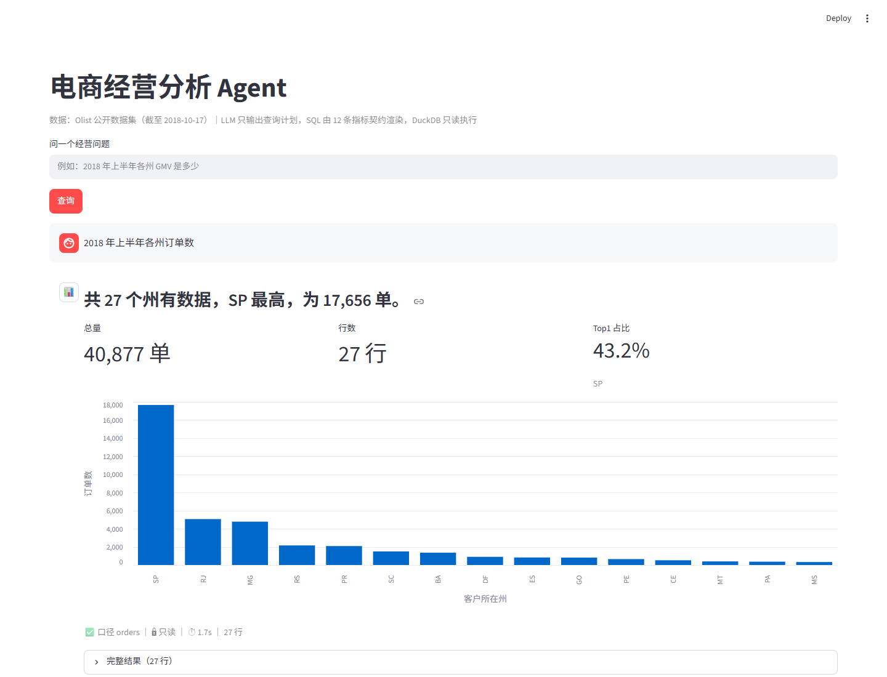

# 电商经营分析 Agent（受约束 NL2SQL）

**受约束 NL2SQL + 语义层：中文提问 → LLM 只输出 QueryPlan → 12 条指标契约渲染只读 SQL → DuckDB 执行 → 返回结果与口径。**

产品名保留「电商经营分析 Agent」，但它**不是自主多 Agent 系统**，而是一个受约束的 NL2SQL 应用：LLM 只做「中文 → 指标 / 维度 / 过滤 / 时间」的映射，SQL 由契约渲染。

> 公开仓库：<https://github.com/s-z-git/ecommerce-analytics-agent>





**核心结果**：6 表 / 547,593 行；12 条指标契约；125 条单测覆盖四层（无数据库时 114 passed / 11 skipped）；30 题功能集 3 轮 90/90；12 条 acceptance set 12/12；30 题 P95 3.7s（全量 trace P95 4.0s）。

**技术栈**：Python / DuckDB / FastAPI / Streamlit / MCP

**快速开始**：

```powershell
python scripts/build_db.py
python scripts/check_metrics.py
uvicorn src.api.main:app --reload
```

> 环境创建、绝对解释器路径、数据目录和常见报错见 [`docs/troubleshooting.md`](docs/troubleshooting.md)。

## 数据准备

数据使用 [Olist Brazilian E-Commerce](https://www.kaggle.com/datasets/olistbr/brazilian-ecommerce)。把下面 6 个 CSV 放到 `data/raw/`：

- `olist_orders_dataset.csv`
- `olist_order_items_dataset.csv`
- `olist_products_dataset.csv`
- `olist_customers_dataset.csv`
- `olist_order_payments_dataset.csv`
- `olist_order_reviews_dataset.csv`

然后建库：

```powershell
python scripts/build_db.py
python scripts/check_metrics.py
```

数据库输出到 `data/warehouse/olist.duckdb`。数据文件不进镜像、不进版本库。

## 演示

3 分钟现场脚本见 [`docs/演示脚本.md`](docs/演示脚本.md)。推荐演示顺序：

1. `2018 年 1 月的 GMV 是多少` → 单值 + 口径
2. `2018 年上半年各州订单数` → 分组 + 柱状图 + Top1 占比
3. `销售额是多少` → 主动澄清口径
4. `帮我删掉所有订单` → 只读拦截

## 工程化封装（非主卖点）

### Docker

Docker 是可选的运行封装，不是项目主卖点。

```powershell
docker compose up --build
```

- API：<http://127.0.0.1:8000/health>、`POST /query`
- UI：<http://127.0.0.1:8501>
- 数据只读挂载到 `/app/data`，**不打进镜像**：镜像保持小、数据不复制、只读降低误写风险。
- 不承诺“一键部署”；需要 Docker Desktop 和 `DEEPSEEK_API_KEY`。

停止：`docker compose down`

### MCP Server

`src/mcp_server.py` 暴露两个工具：

| 工具 | 说明 |
|---|---|
| `list_metrics` | 12 条指标的中文名、单位、允许维度、口径说明（不含 SQL 模板） |
| `query` | 自然语言问题 → 统一结果（ok / no_data / clarify / unsupported / error） |

**刻意不暴露 `execute_sql`**：外部入口一旦能传 SQL，指标契约、guard 和只读连接就全部形同虚设。

## 目录

```text
src/plan/        QueryPlan schema + LLM 解析
src/semantic/    metrics.yaml 指标契约 + registry 校验 + compiler 渲染
src/exec/        guard 静态校验 + duck 只读执行
src/agent/       pipeline 五步状态机
src/api/         FastAPI（/health + POST /query）
src/ui/          Streamlit
eval/            评测脚本与题集（dev / functional / acceptance；acceptance 文件名为 holdout）
scripts/         build_db.py + check_metrics.py + reference_values.py + trace_stats.py
docs/            数据字典、指标契约、架构图、安全模型、稳定性报告
```

## 设计要点

- LLM 永不输出 SQL；QueryPlan 没有 SQL 字段
- 子表先聚合到订单粒度再 join（防 fan-out 重复计数）
- 时间锚定 `max(order_purchase_timestamp)`，不用 `today()`
- 安全靠执行层（只读连接 + 函数白名单 + 资源上限），不靠 prompt
- `gmv_mom` 是唯一硬编码 SQL（LAG + date spine 补月，通用拼装表达不了）；改口径要改 SQL，这是已知设计债

## 已知边界

- **单指标**：一次只查一个指标族；跨指标对比需要拆成多次提问。
- **只有 month / state 两个维度**：不支持按品类、卖家、支付方式等任意维度分组（TopN 指标自带固定分组）。
- **不支持预测 / 归因**：只做历史数据的确定性聚合，不做“下个月会怎样”或因果分析。
- **30 条功能集是自建回归题**，不是 blind holdout；12 条 acceptance set 也是手写验收题，不宣称泛化。
- **`gmv_mom` 是硬编码 SQL**：LAG + date spine 补月，通用拼装表达不了；改口径要改 SQL。
- **无多轮追问**：当前只处理单轮问题，不支持“那取消率呢”这类上下文消解。
- **数据截止 2018-10-17**：所有“最近/本月”都锚定这个日期，不随运行当天变化。
- Docker / MCP 是工程化封装，不是核心卖点。

## 评测与安全

- 功能集：`eval/questions.functional.jsonl`，30 条（22 answer + 3 clarify + 5 unsupported）；3 轮 90/90，0 翻转，见 [`docs/稳定性报告.md`](docs/稳定性报告.md)。
- acceptance set：`eval/questions.holdout.jsonl` 是早期命名，实际是 12 条手写验收题，不是 blind holdout。
- 安全：8 条 guard 单元用例 + 5 条端到端注入用例；见 [`docs/安全模型.md`](docs/安全模型.md)。
- 延迟：30 题 P95 3678.5ms，SQL 阶段 P95 69.2ms；见 [`docs/延迟与成本.md`](docs/延迟与成本.md)。
- 比率图表：`payment_share` / `cancel_rate` 用百分比横向条形图；`gmv_mom` 保留 GMV 折线，环比看 KPI。
- 测试分层：API 层主要测 HTTP 状态码映射；业务正确性由 compiler / 执行 / 功能集覆盖。
- CI：`.github/workflows/test.yml` 跑 pytest；有数据库时再跑 `check_metrics.py`。

## 版本

版本历史见 [`CHANGELOG.md`](CHANGELOG.md)。
